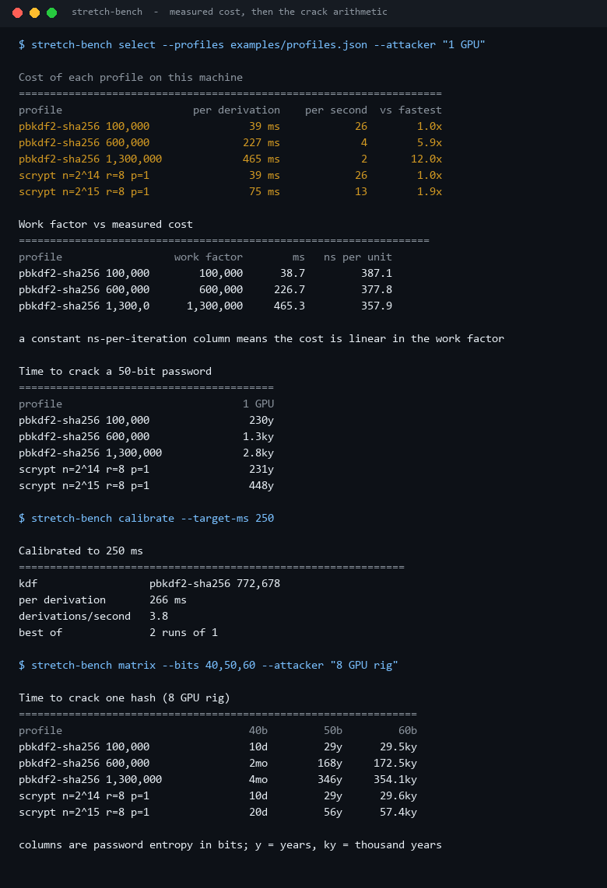
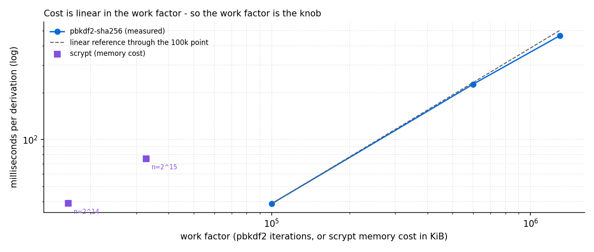
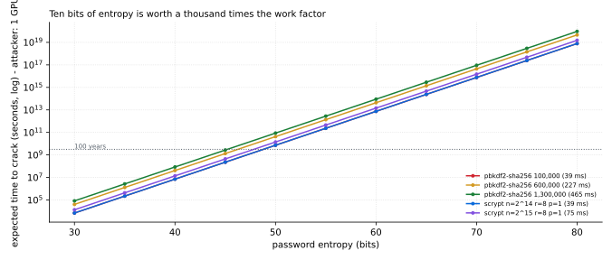

# Password-Stretch-Bench

**Two questions, one tool: how long does your password hashing actually take on this machine, and how long would it take an attacker to undo it?**

It times `PBKDF2-HMAC-SHA256` and `scrypt` (both from the standard library), calibrates a work
factor to a target latency, and converts the measured rate into a time-to-crack table.



Every profile and every calibration figure in this README was measured by
`scripts/render_assets.py` on the machine that generated the committed `docs/results.json`.

---

## Table of contents

- [Why this exists](#why-this-exists)
- [Cost is linear, so the work factor is the knob](#cost-is-linear-so-the-work-factor-is-the-knob)
- [Calibration: how many iterations for 250 ms](#calibration-how-many-iterations-for-250-ms)
- [From rate to time-to-crack](#from-rate-to-time-to-crack)
- [Entropy beats work factor](#entropy-beats-work-factor)
- [Install and run](#install-and-run)
- [Commands](#commands)
- [Design notes and limits](#design-notes-and-limits)
- [Tests](#tests)
- [License](#license)

---

## Why this exists

Every "use 600,000 PBKDF2 iterations" recommendation is a **guess about hardware**. On a modern
desktop core 600k costs 227 ms; on a small cloud vCPU it can cost 800 ms, and on a phone it is a
visible stall in the login flow. The number that matters is not the iteration count - it is the
wall-clock cost, and the only way to know it is to measure it on the machine that will run it.

This tool answers, with measurements rather than folklore:

1. **What does each candidate profile cost here?** Best-of-N timing of a batch of derivations.
2. **What work factor hits my latency budget?** Two or three measurements, then a scale-and-refine.
3. **What does that buy against an attacker?** Key space ÷ guess rate, expressed in years.

## Cost is linear, so the work factor is the knob



| Profile | Cost per derivation | Derivations / second | Cost of one guess |
| --- | ---: | ---: | ---: |
| `pbkdf2-sha256` 100,000 | 38.7 ms | 25.8 | 387 ns/iteration |
| `pbkdf2-sha256` 600,000 | 226.7 ms | 4.4 | 378 ns/iteration |
| `pbkdf2-sha256` 1,300,000 | 465.3 ms | 2.1 | 358 ns/iteration |
| `scrypt` n=2^14 (16 MiB) | 38.9 ms | 25.7 | - |
| `scrypt` n=2^15 (32 MiB) | 75.4 ms | 13.3 | - |

The ns-per-iteration column is the point: 387, 378, 358 - flat within 8% across a 13× range of
work factors. PBKDF2 cost is effectively `iterations × 375 ns` on this machine, which is why
"double the iterations" is a predictable, boring knob, and why a profile can be tuned to a target
instead of guessed.

`scrypt` also scales with memory cost here (16 MiB → 39 ms, 32 MiB → 75 ms), but the interesting
part of scrypt is not its duration - it is that each guess needs the memory, which changes the
attacker's economics in a way a pure clock cannot show. See the limits section.

## Calibration: how many iterations for 250 ms

```
$ stretch-bench calibrate --target-ms 250
Calibrated to 250 ms
==============================================================
kdf                  pbkdf2-sha256 772,678
per derivation       266 ms
derivations/second   3.8
best of              2 runs of 1
```

The algorithm is deliberately not a binary search over timings: it probes once, scales the work
factor by `target / measured`, then refines at most three times. On a machine that takes ~375 ns
per iteration, 250 ms lands at **772,678 iterations = 266 ms** - within 7% of the target in two
timing runs.

The same command for scrypt picks a power of two: `--target-ms 250 --kind scrypt` selected
**n=2^17 (128 MiB) at 326 ms**, because 2^16 overshot less but 2^17 landed closer on this run.
That is the honest behaviour of a power-of-two search: it can miss on either side, and it reports
the duration so you can see by how much.

Caveat worth stating plainly: this number is a property of *this* CPU. Re-run it on your
production hardware; the point of the tool is that the answer is a measurement, not a constant.

## From rate to time-to-crack

A leaked hash database gives the attacker a fixed number of guesses per second. Divide half the
key space by that rate:

| Profile (cost here) | 40 bits | 50 bits | 60 bits | 70 bits |
| --- | ---: | ---: | ---: | ---: |
| `pbkdf2-sha256` 100k (39 ms) | 3mo | 230y | 236.0ky | 241.7My |
| `pbkdf2-sha256` 600k (227 ms) | 1.3y | 1.4ky | 1.4My | 1.4e+09y |
| `pbkdf2-sha256` 1.3M (465 ms) | 2.8y | 2.8ky | 2.9My | 3.0e+09y |
| `scrypt` 2^14 (39 ms) | 3mo | 231y | 236.9ky | 242.6My |
| `scrypt` 2^15 (75 ms) | 5mo | 447y | 457.8ky | 468.8My |

Attacker assumption for that table: **1 GPU = 3,000× the measured single-core rate**. The
multiplier is an explicit, editable assumption (`stretch-bench attackers` lists all five), because
that is the part of a crack estimate everyone actually disagrees about.

The uncomfortable reading: a 40-bit password is measured in months even behind the strongest
profile here, while a 60-bit one is measured in thousands of centuries. The KDF is a multiplier on
a number that is set by the password, not a substitute for it.

## Entropy beats work factor



The lines are parallel because both axes are logarithmic: every 10 bits of entropy multiplies the
attacker's work by ~1,000, while every doubling of the work factor multiplies it by 2.

- going from 100k to 1.3M iterations (13× the work, 12× the login latency) buys **13×** attack cost;
- going from 50 to 53 bits of entropy (three more characters from a 94-character alphabet) buys **8×**;
- going from 50 to 60 bits buys **1,024×** - for zero extra CPU on the server.

```
$ stretch-bench required-entropy --that-many-years 10 --attacker "8 GPU rig"
profile        pbkdf2-sha256 600,000  (216 ms)
attacker       8 GPU rig  (111,031 guesses/second)
target         10 years
needed         46.0 bits of password entropy
```

That last command is the practical one: it inverts the whole table into a single password-policy
number for your stack.

## Install and run

Standard library only at runtime.

```bash
python -m pip install -e ".[dev]"
stretch-bench select --profiles examples/profiles.json
```

From a checkout without installing:

```bash
PYTHONPATH=src python -m password_stretch_bench select --profiles examples/profiles.json
```

## Commands

| Command | What it answers |
| --- | --- |
| `measure --kind --iterations --memory` | what does one parameter set cost here? |
| `calibrate --kind --target-ms` | which work factor hits my latency budget? |
| `select --profiles FILE` | cost, linearity and crack time for every profile |
| `matrix --bits 40,50,60` | crack-time grid of profiles × password entropy |
| `crack --entropy --rate` | one estimate, formatted |
| `required-entropy --that-many-years` | the password-policy number (bits) |
| `password --charset --length` | entropy of a uniformly random password |
| `attackers` | the attacker-rate assumptions, so you can argue with them |

## Design notes and limits

- **Best-of-N, batched.** Timing a single 39 ms call is fine; timing a single 1 ms call is noise.
  Every measurement runs a batch inside each timed region and keeps the **fastest** batch, because
  the fastest run is the one least disturbed by the scheduler.
- **`measure` is wall clock, so it is hardware-specific.** The committed numbers come from one
  machine; treat the *shape* (linearity, ratios) as portable and the absolute numbers as local.
- **The attacker rate is a single multiplier for both KDFs.** Real GPUs are far worse at scrypt
  than at PBKDF2 at the same wall-clock cost, because scrypt needs memory bandwidth per guess. A
  uniform multiplier therefore *understates* scrypt's advantage - the honest way to use this table
  is to lower the multiplier for memory-hard profiles.
- **No bcrypt or Argon2.** Python's standard library has neither. `argon2-cffi` and `bcrypt` are
  the right choices in production; this project benchmarks what needs no wheels to install.
- **Time-to-crack assumes uniform random passwords.** Human-chosen passwords collapse far faster
  than their character-class entropy suggests; the `password` command computes the uniform case
  only, and says so.
- **No secret material is measured.** The password and salt are fixed public constants from this
  repository; nothing from your machine or environment is read.

## Tests

```bash
PYTHONPATH=src python -m pytest -q     # 48 passed
python -m ruff check .                 # All checks passed!
```

48 tests cover derivation determinism, every rejection path (zero iterations, non-power-of-two
scrypt, unknown KDF), best-of-N timing and batching with an injected fake clock, calibration for
both KDFs, the crack arithmetic and its inverse, duration formatting, every report, and every CLI
command including the JSON outputs.

## License

MIT. See [LICENSE](LICENSE).

---

<sub>Screenshots and charts are generated by `scripts/render_assets.py` from this repository's own
measurements. No third-party images are used, and no credentials or secrets exist in this
repository.</sub>
